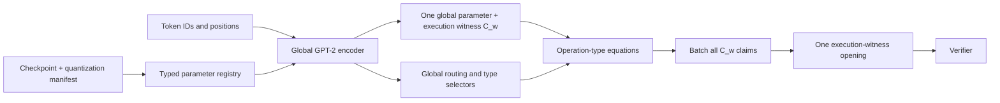

# GPT-2 typed-parameter HD-R1CS proof design

## Status

**End-to-end public-support mode implemented; zero knowledge remains partial.**
The integer LayerNorm/Softmax normalization slice is
implemented and tested in `hdr1cs/global_mlp/normalization.rs`; its Softmax now
combines tagged lookup relations with an exact Qq row-sum relation. The generic
global MLP statement now binds public input/output, the declared model
commitment, the public manifest, and the manifest-derived model-slot layout to
one global witness opening. `hdr1cs/gpt2.rs` now parses the PR1GPT2 Q12 bundle,
streams parameter chunks, reproduces the complete integer GPT-2 reference
execution, and compiles public metadata into one stable 272-block namespace.
Parameters, public token IDs and all 123 semantic operation outputs feed one
global BVA witness source. A real GPT-2 Small server run matched all 50,257
reference logits and generated one SmartPC `C_w` commitment over 125,159,765
physical entries with zero padding group operations; see
`outputs/gpt2_q12_bva_commit_server_result.md`.

The complete GPT-2 primitive relation is now compiled. Public I/O, every
non-range linear relation, range recomposition, and every bilinear relation
kind (including rectangular matmul, causal QK/PV and the tied LM head) produce
real routed leaf claims. Those claims, their secret-secret EO terminals, and
the tagged-lookup input/output/range-limb leaf are synchronized into one EO
reduction and one SmartPC opening against the original global `C_w`, with no
witness-padding materialization. The challenge schedule is derived from the
public statement, `C_w`, and preceding proof messages.

The remaining cryptographic gap is narrower but still decisive: both timestamp
and multiplicity vectors now have hiding SmartPC commit/open paths. Timestamps
are replayed from the authenticated query stream in bounded chunks; the sparse
multiplicity source visits only nonzero counts. Both paths leave BVA padding
virtual, and reciprocal keys outside `[1, token_count * Q]` are rejected.
The canonical timestamp commitment now has a verifier-side global range
argument: replayed bit planes are recombined at one random BVA point, their
`bit - 1` views are bound to the public physical mask, and a commitment-bound
random MLE is reduced with EO and opened against the same bit commitments.
This path keeps all BVA padding virtual and has been exercised end-to-end on
the 3,878-query tiny fixture. It is not yet a zero-knowledge range proof,
because the current EO object exposes random folded witness scalars.
Sparse multiplicities now have an exact verifier-side upper-bound argument:
count and `Q-count` slack are range checked on hidden support, a one-bit support
commitment is checked with `b*b=b`, and a random opening enforces
`count + slack = Q*support` without materializing zero table rows. The Lasso
left/right factor commitments also have a bounded-RAM prefix-product proof
covering within-vector shifts, cross-vector boundaries, the initial one, and
the public terminal product. A commitment-bound affine proof now enforces
`factor = constant + alpha*value + beta*counter`; both sides share one
compressed-value commitment, and routed equality proofs bind the right counter
and the left query-counter to the canonical timestamp commitment. Query and
table tails use separate physical vectors, so the timestamp routing is exact
without materializing padding. A public query TBV now reuses the same lookup
routing challenges as the authenticated global `C_w` leaf. Its table-tail
coefficients are zero, and a committed-evaluation proof binds the shared
compressed-value commitment to the exact global lookup claim plus public tag
offset. The value commitment is absorbed before those routing challenges, and
the exact compact TBV terms/layout are absorbed into the evaluation-proof
challenge. Contiguous coefficient intervals are represented as aligned dyadic
subcubes instead of a query-sized dense vector. The product challenge is now
sampled only after multiplicity, timestamp, query/table value, and query/table
counter commitments have entered the Fiat--Shamir transcript.

The current soundness-first mode closes the final table seam by publishing the
sorted nonzero support. The verifier reconstructs multiplicity, table-value,
and table-count commitments from the public registry, disclosed counts, and
three disclosed hiding scalars; combined query/table commitments are checked
by group and tier-one linearity. Only nonzero support entries contribute to
the sparse commitment, so unused public table rows and BVA padding perform no
IP or group operations. This completes Lasso membership soundness but leaks the
lookup access distribution. A hidden-index compaction/permutation proof must
replace the public support before claiming zero knowledge. The count proof's
per-bit SmartPC openings also require batching before a real-model run. The
repository now has a serializable aggregate `Gpt2Proof` and a statement-only
verifier. The aggregate binds the global relation proof, the Lasso proof, and
the exact randomized lookup projection opened from the same global `C_w`; its
exact decoder rejects truncation and trailing bytes. The completed mode is
nevertheless explicitly non-ZK: the sorted nonzero support/counts, three sparse
commitment hiding scalars, and EO folded scalars are disclosed. It also has only
been benchmarked as an aggregate proof on the 3,878-query tiny fixture, not on
the real GPT-2 Small checkpoint.

The `gpt2_end_to_end` production bench exposes separate artifact-generation and
standalone-verification commands. Generation writes exact `gpt2.statement`,
`gpt2.params`, and `gpt2.proof` files; verification reloads only those files.
The server-generated tiny artifact was transferred back to the local workspace
and its hashes and statement-only verification were checked again. This closes
the executable artifact boundary, but does not change the public-support or
tiny-fixture limitations above.

The latest v7 fixed-binary server run exercises the grand product, affine
relations, two timestamp routes, query/global-`C_w` proof, corrected challenge
schedule, and public-support table reconstruction three times. All factor
bindings average 14.752247/1.869368 s for proving/verification; the five proof
objects plus 528-byte public support/hiding payload total 348,664 bytes. Test
wall time and direct-PID VmHWM average 36.476988 s and 49,377.333 KiB. All
padding and unused-table-row work counters remain zero. These measurements
cover the 3,878-query tiny fixture, not a real GPT-2 Small proof, and the
public-support mode is explicitly non-ZK.

The sparse exact-count argument has also been measured once on the server with
the fixed test binary: proving took 716.981839 s, verification 14.541467 s,
wall time 758.651022 s, and direct test-PID VmHWM was 87,172 KiB. Its largest
live sparse set was 54 entries, its largest SmartPC projection was 8,192
entries, and all padding-work counters remained zero. This is one run rather
than a mean; it confirms the bounded-RAM seam but also makes batching the 25
independent bit-proof openings a prerequisite for real-model experiments.

本文把“不同参数类型”同时分成两个维度：一是 embedding、matrix、bias、
LayerNorm parameter 和 tied view 等语义参数族；二是 Q12、mixed precision、scale、
zero point 和 accumulator width 等数值表示。它不是把 GPT-2
Small/Medium/Large/XL 分别做成不同协议；模型规模只改变 manifest 中的
dimensions，proof relation 保持不变。

设计目标是在现有 heterogeneous global HD-R1CS 上证明一个**确定的整数 GPT-2
推理语义**。它不直接证明 PyTorch 浮点计算，也不宣称量化后的模型精度。

## 1. 推荐的 public statement

对 public architecture/quantization manifest $M$、模型参数 commitment
$C_\theta$、输入 $x$ 或输入 commitment $C_x$、public output $y$，证明：

> 存在 typed parameter collection $\theta$ 和 execution witness $w$，使得
> $\theta$ 打开 $C_\theta$，$w$ 打开 online witness commitment $C_w$，并且
> $y=\operatorname{GPT2Int}_M(\theta,x)$。

第一阶段建议使用 public token IDs 和 public final-token logits。private prompt
应作为后续模式，通过 $C_x$ 和 authenticated embedding lookup 接入，不能把固定
prompt 的 selector 当成通用 private-input proof。



当前实现遵循用户指定的最小在线原型：参数、public I/O 和 activations 都进入一个
`C_w`，不生成离线随机隐藏的 `C_{\mathrm{arch}}`、`C_\theta` 或可复用架构合法性
证明。将来若需要跨 inference 复用 checkpoint，可把 `C_\theta` 拆出；这不是当前
完整性验收的前置条件。

## 2. Typed parameter registry

每个参数 block 必须绑定 descriptor：

```text
ParameterDescriptor {
    parameter_id,
    parameter_kind,
    true_shape,
    signed_bit_width,
    scale_exponent_or_multiplier,
    zero_point,
    storage_orientation,
    sharing_rule,
}
```

descriptor 属于 public manifest 或 architecture commitment，不能只依赖 prover
解释。同一组 field values 若在不同 shape、scale 或 transpose 语义下解释，会产生
不同计算，因此 metadata tampering 必须导致验证失败。

### 2.1 GPT-2 Small 参数族

下表使用 GPT-2 Small 的标准 dimensions：12 blocks、hidden width 768、12 heads、
head dimension 64、MLP width 3072、vocabulary 50,257、maximum position 1,024。

| Parameter kind | Logical shape | Proof treatment |
|---|---:|---|
| Token embedding `W_E` | `50,257 x 768` | Committed embedding table；按 token ID gather |
| Position embedding `W_P` | `1,024 x 768` | Committed embedding table；按 public position gather |
| Attention LayerNorm `γ, β` | two vectors of `768` per block | Diagonal elementwise scale + broadcast add |
| Q/K/V weights | three `768 x 768`, or fused `768 x 2,304` | Dense rectangular matmul parameter blocks |
| Q/K/V bias | three vectors of `768`, or fused `2,304` | Broadcast parameter vectors |
| Attention output weight | `768 x 768` | Dense matmul parameter block |
| Attention output bias | vector `768` | Broadcast parameter vector |
| MLP LayerNorm `γ, β` | two vectors of `768` per block | Diagonal elementwise scale + broadcast add |
| MLP expansion weight/bias | `768 x 3,072`, vector `3,072` | Rectangular matmul + broadcast |
| MLP projection weight/bias | `3,072 x 768`, vector `768` | Rectangular matmul + broadcast |
| Final LayerNorm `γ, β` | two vectors of `768` | Diagonal elementwise scale + broadcast add |
| LM head | `768 x 50,257` view | Tied transpose view of `W_E`; no second parameter copy |
| Quantization coefficients | low-dimensional vectors/scalars | Public or committed manifest parameters |
| Nonlinear tables | GELU, exp, reciprocal, inverse square root | Public/preprocessed tables with lookup arguments |

Checkpoint storage orientation must be normalized by the frontend. For example, a fused checkpoint
matrix and three logical Q/K/V matrices may share bytes but must emit one unambiguous algebraic
orientation.

### 2.2 Parameter sharing

GPT-2 的 LM head 与 token embedding weight tying 应由同一个 `parameter_id` 加一个
transpose view 表示。禁止复制一份相等数值再分别 commitment；那会把 parameter
sharing 降级为未证明的 frontend 假设。

Q/K/V 可以保留 fused block 以匹配 checkpoint，也可以分解为三个 views。无论选择
哪种形式，manifest 必须承诺 slice offsets、shape 和 orientation。

## 3. Quantized semantics

### 3.1 两阶段量化路线

建议先实现 **Q12 compatibility mode**：所有 checkpoint values 使用 scale
$2^{12}=4096$，以便复用已经验证过的 bit-exact reference 方法。其目标是证明语义
一致，不是优化 proof cost。

第二阶段再实现 **mixed-precision mode**：例如低位 weights、较宽 activations、
bias/accumulator 和每 block scaling。具体 bit widths 必须由 exporter 与独立 reference
共同确定，不能在 proof code 中隐式推断。

### 3.2 Requantization

对每个 arithmetic output 固定 integer multiplier $m$ 和 shift $r$，将 rescale 写成：

$$
t=m\cdot a,\qquad t=2^r q+e,
$$

其中 quotient $q$、remainder $e$、rounding rule 和 saturation flags 都受 range
constraints 约束。随后证明：

$$
y=\operatorname{Clamp}_k(q).
$$

必须明确 floor、round-to-nearest 或 ties-to-even 中的一个。field division 不能替代
integer truncation。

### 3.3 No-wrap condition

manifest 为每种 operation 给出 accumulator bound。选择 field $\mathbb F_p$ 时必须
保证所有合法 signed intermediates 在 canonical embedding 下不会模 $p$ wrap-around。
这既是 theorem assumption，也应由 compiler 的静态 bound checker 验证。

## 4. Global operation types

整个 GPT-2 graph 先编码，再按 operation type 证明；不能使用
`for transformer_block { prove_block }` 作为顶层 statement。

建议的 operation taxonomy：

| Type | GPT-2 use |
|---|---|
| `gather` | Token and position embeddings |
| `matmul` | Q/K/V/O、attention score/value、MLP、LM head |
| `add` | Bias、embedding sum、residual connections |
| `hadamard` | LayerNorm scale、attention probabilities、auxiliary products |
| `reduce_sum` | LayerNorm mean/variance、softmax denominator |
| `requantize` | Scaling、rounding、saturation after integer operations |
| `lookup` | GELU、exp、reciprocal、inverse square root |
| `compare/select` | Softmax max、clamp、causal-mask selection |
| `permute/view` | Head split/merge、transpose、tied LM-head view |

`permute/view` 应尽量成为 committed routing，而不是复制 witness。所有同类型 gates
跨 12 个 blocks 和所有 token positions 聚合成同一 equation group。

## 5. Transformer subrelations

下式均指 manifest 指定的 integer/requantized operations。

### 5.1 Embedding

对 token $t_j$ 和 position $j$：

$$
X_j^{(0)}=W_E[t_j]+W_P[j].
$$

- public token mode：selector 由 public token ID 确定；
- private token mode：必须证明 selector one-hot/lookup membership，并把 token commitment
  绑定到同一 selector。

### 5.2 LayerNorm

不要在 field 中直接除以 hidden width 或计算实数平方根。对 width $d$，可使用整数
numerators：

$$
s=\sum_i x_i,\qquad c_i=d x_i-s,
$$

$$
v=\sum_i c_i^2,qquad r=\operatorname{InvSqrtLUT}(v;M),
$$

$$
y_i=\operatorname{Requantize}(\gamma_i c_i r+\beta_i;M).
$$

`InvSqrtLUT` 的 domain、epsilon、clamping 和 rounding 都由 manifest $M$ 固定。

### 5.3 Multi-head attention

$$
Q=XW_Q+b_Q,\quad K=XW_K+b_K,\quad V=XW_V+b_V.
$$

head split/merge 是 routing。每个 head：

$$
S=\operatorname{Requantize}(QK^\top;M),
$$

然后应用 public causal mask。Softmax 使用稳定整数语义：

$$
m_i=\max_j S_{ij},\qquad e_{ij}=\operatorname{ExpLUT}(S_{ij}-m_i;M),
$$

$$
z_i=\sum_j e_{ij},\qquad
P_{ij}=\operatorname{DivRound}(e_{ij},z_i;M).
$$

必须分别证明 max/select、exp lookup、denominator sum、integer division/remainder 和
range。之后：

$$
H=PV,\qquad A=HW_O+b_O,\qquad X'=X+A.
$$

### 5.4 MLP and GELU

$$
U=XW_1+b_1,\qquad G=\operatorname{GELULUT}(U;M),
$$

$$
R=GW_2+b_2,\qquad X_{\mathrm{next}}=X'+R.
$$

GELU 证明的是 manifest 固定的 bounded integer table，不是连续实函数。

### 5.5 Final LayerNorm and LM head

$$
H_f=\operatorname{LayerNorm}(X_L;\gamma_f,\beta_f),
$$

$$
\mathrm{logits}=H_f W_E^\top.
$$

第一阶段建议 public output 为 final-token 的全部 50,257 个 integer logits。只公开
argmax 会额外需要全局比较/最大值证明，不能只输出 prover 声称的 token ID。

## 6. Commitments and batching

推荐 commitment 边界：

| Commitment | Contents | Lifetime | Target openings |
|---|---|---|---:|
| `C_arch` | graph、routing、selectors、typed descriptors | model/offline | separate architecture batch |
| `C_θ` | embeddings、weights、bias、LayerNorm parameters | model/offline | one final parameter opening |
| `C_table` | nonlinear lookup tables or their authenticated roots | preprocessing | lookup-specific |
| `C_w` | input-dependent activations and auxiliaries | per inference | one final witness opening |

所有 `C_θ` claims 与所有 `C_w` claims 必须分别使用 sound batching。不能把来自两个
不同 commitments 的 reduced values 在没有 multi-commitment argument 的情况下只打开
其中一个。

现有 heterogeneous synchronized projection 方法可以复用，但每个 commitment batch
都必须：

1. 使用确定的 claim order 和 domain separation；
2. 使用 shared folding challenges；
3. 检查所有 final reduced commitments 相等；
4. 对该 commitment 执行一次真实 PCS opening；
5. 验证 transcript 完整消费。

## 7. RAM-controlled prover

保持 global statement 不等于必须把整个 padded execution trace 同时展开。

- 参数与 activation 都使用 true-size heterogeneous blocks；
- attention 的 `S x S` blocks 只保存有效 sequence 区域；
- 采用 deterministic replay：一次生成 commitment cache，一次按 operation group
  生成 projections/openings；
- `C_θ` 和 nonlinear table preprocessing 可跨 inference 复用；
- equation groups 使用可配置 bounded parallelism，而不是固定全部并发；
- final batching 使用 projection views，不构造 logical padded vectors；
- 单独报告 physical entries、logical padded entries、commitment cache、equation peak
  和 final-opening peak。

sequence length 对 attention witness 是二次项。固定四 token 的 smoke test 不能预测
1,024-token full-context RAM，必须做独立 length sweep。

## 8. Development plan

### Phase A — Bit-exact frontend

1. 定义 `Gpt2Manifest`、`ParameterDescriptor` 和 checkpoint manifest hash；
2. 导出 GPT-2 Small Q12 参数，并固定 matrix orientation；
3. 独立 Python/NumPy reference 与 Rust executor 逐项匹配全部 logits；
4. 先固定 public four-token prompt，再扩展可变 public input。

完成标准：不运行 proof 时，Rust 与独立 reference 的所有中间 checkpoints 和最终
50,257 logits bit-for-bit 一致。

### Phase B — Typed parameter commitment

1. 实现 matrix、vector、embedding、low-dimensional scale 和 tied-view descriptors；
2. 将模型参数写入 heterogeneous `C_θ`；
3. 证明 token/position gather、bias broadcast、LayerNorm diagonal scale 和
   `W_E^T` tying；
4. 加入每种 parameter kind 的 metadata/value tampering tests。

### Phase C — Linear GPT-2 core

先实现 embedding、Q/K/V/O、attention matmuls、residual、MLP matmuls 和 LM head，
暂时使用 externally supplied nonlinear outputs，但明确标记 proof incomplete。

完成标准：所有 linear relations、routing、parameter bindings 和两类 final openings
验证通过；任何 nonlinear witness tampering 仍应被临时边界测试捕获或明确拒绝运行
“complete”模式。

### Phase D — Nonlinear integer semantics

依次加入：

1. requantize/truncate/clamp；
2. GELU lookup；
3. LayerNorm inverse-square-root lookup；
4. Softmax max、exp、sum 和 division；
5. 所有 range/lookup/table binding tests。

当前进度：GELU、clamp/saturation、LayerNorm、Softmax 和 causal multi-row attention
均已进入完整 primitive relation/leaf；range、timestamp、multiplicity、factor recurrence
与公开-support table membership 的 soundness 已接通。当前公开的是稀疏 table support，
EO terminal/round scalars 也未隐藏，因此仍是 non-ZK 模式。

### Phase E — End-to-end proof

1. global operation-type proof；
2. one `C_θ` opening + one `C_w` opening；
3. public I/O binding；
4. server-side verification；
5. proof serialization and negative-test corpus。

### Phase F — Scaling experiments

按以下顺序执行：

1. synthetic tiny Transformer：`d=8`, `heads=2`, `seq=4`；
2. GPT-2 Small Q12，固定 4-token prompt；
3. sequence lengths `4, 16, 64, 128`；
4. full context only after RAM extrapolation passes；
5. GPT-2 Medium/Large/XL 只在 Small 的语义与 batching 稳定后测试。

每次报告：parameter commitment、witness commitment、各 operation group、lookup、
parameter/witness PCS openings、proof bytes、verifier、physical/logical entries、peak RSS
和 reference match。

## 9. Required negative tests

- 修改任一 token/position embedding row；
- 交换 Q/K/V slices 或改变 fused offsets；
- transpose/orientation metadata tampering；
- 修改任一 matrix weight、bias、LayerNorm $\gamma/\beta$；
- 将 tied LM head 换成独立未绑定 copy；
- scale、bit width、zero point、rounding 或 saturation metadata tampering；
- causal mask、head split/merge、residual routing tampering；
- GELU/exp/inverse-sqrt/reciprocal table row tampering；
- division quotient/remainder 或 range witness tampering；
- token ID、public logits 或 final-token selection tampering；
- truncated/trailing transcript；
- `C_θ`/`C_w` claim-order permutation；
- distinct-matrix reduced-commitment attack；
- padding-region and true-shape tampering。

## 10. Evidence boundary

过去的独立 GPT-2 Small Q12 实验可以作为 frontend/reference 目标：12 blocks、width
768、12 heads、MLP 3072、vocabulary 50,257、124,439,808 parameters；固定四 token
时 Python/NumPy 与 Rust 曾逐项匹配所有 logits，并完成另一证明系统的服务器验证。

这些数据不是当前 zksmart GPT-2 HD-R1CS 的实现或性能结果。当前仓库可以声称：
LayerNorm/Softmax 的整数 normalization slice 已完成本地 setup/prove/verify 和负向测试。
在完成其余 phases 并重新运行 full-model end-to-end proof 前，仍不能声称“GPT-2 已被
zksmart 证明”。
