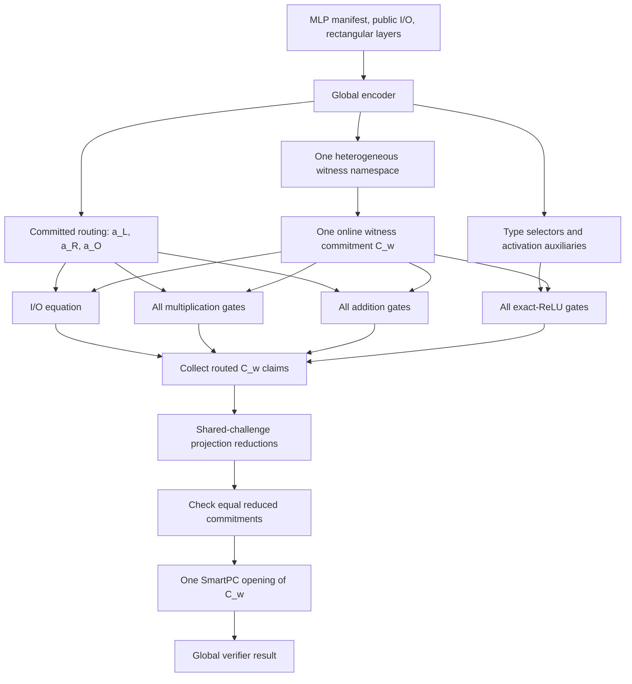

# Heterogeneous HD-R1CS：实现与实验记录

本文记录截至 2026-08-10 已完成的 heterogeneous-size HD-R1CS 开发、正确性
边界、测试证据和服务器实验。统一术语见 [CONTEXT.md](../CONTEXT.md)，关键决策
见 [ADR-0001](adr/0001-use-one-global-hd-r1cs-instance.md) 与
[ADR-0002](adr/0002-batch-global-witness-claims-to-one-opening.md)。

## 1. 最终目标与边界

目标是证明一条宽度逐层减半的 MLP：

\[
x_{i+1}=\sigma(W_i x_i+b_i),
\]

其中 `W_i` 是 `width[i+1] x width[i]` 的长方形矩阵，不同层拥有不同 true
shape。当前 `sigma` 实例化为 exact ReLU。

实现必须同时满足：

- 一份 global HD-R1CS instance，而不是 `Vec<LayerProof>`；
- 所有 layer 的 wire 使用统一 block namespace；
- equation 按 I/O 和 operation type 组织；
- 一份 online global witness commitment `C_w`；
- 所有 routed witness claims 最终只打开一次 `C_w`；
- padded zeros 不物化，使 RAM 与 physical entries 而非 logical padded domain
  保持关联；
- verifier 检查完整 transcript、routing、operation equations 和最终 witness
  opening。

不在当前完成范围内的内容：quantized sigmoid lookup、private dimension
consistency，以及将 architecture/I/O commitments 和 `C_w` 合成一个 PCS proof。

## 2. 协议组织



### 2.1 Global encoding

[`GlobalHdR1csMlpProtocol::encode`](../zksmart/src/hdr1cs/global_mlp.rs)
将 public input、weights、bias、preactivations、ReLU outputs 和 activation
auxiliaries 放入一个 global block namespace。相邻层复用同一个
`GlobalBlockId`，所以 cross-layer equality 是同一 witness block 的重用，而不是
两份 layer commitment 之间的 equality proof。

`GlobalOperationType` 只有 multiplication、addition 和 activation。编码器构造
全局 `a_L/a_R/a_O` wiring、每种 operation selector、I/O selector，以及 ReLU
negative/output-bit auxiliaries。

### 2.2 Heterogeneous virtual storage

[`HeteroBlockMat`](../zksmart/src/utils/heterogeneous.rs) 为所有 block 提供共同的
power-of-two slot domain，但只保存每个 block 的 true-size columns。超出 true
shape 的区域在投影时被解释为 zero。

715M 实验中：

| Storage boundary | Entries |
|---|---:|
| Physical global witness | 716,090,019 |
| Logical padded witness | 137,438,953,472 |
| Logical / physical | 191.93x |

因此实现不能构造等-size `BatchPoints` 所需的完整 padded `a_vec/b_vec`。
`StackedHeteroView` 的 left/right projections 按输出列或全局行并行，只分配
投影结果，不复制 padded matrix。

### 2.3 Equation groups

proof object 包含四个顶层 equation groups：

1. **I/O binding**：public/offline I/O commitment 与 global witness 中相应 blocks
   的 routed evaluations 一致；
2. **Multiplication**：所有矩阵乘法 gates 共同进入一次 global equation；
3. **Addition**：所有 bias/addition gates 共同进入一次 global linear relation；
4. **Activation**：所有 exact-ReLU gates 共同验证 linear relation、zero product、
   output range、negative-part range 和 bit booleanity。

设置 `ZKSMART_PARALLEL_EQUATIONS=1` 只改变这四组证明的调度，不改变 statement
或 verifier。关闭它可以用更长运行时间换取更低并发工作集。

## 3. 单次 `C_w` opening

### 3.1 为什么不能直接复制等-size `BatchPoints`

等-size [`HdR1csMuls`](../zksmart/src/hdr1cs/muls.rs) 用 Fiat-Shamir 随机系数
线性组合多个 `block_w` evaluation claims，再生成一次 PCS opening。直接用于
heterogeneous global domain 会构造长度等于 logical padded entries 的 dense
vectors；在完整实验中是 137,438,953,472 个 field positions，违背 RAM 目标。

### 3.2 Virtual synchronized reduction

[`BatchProjectionPoints`](../zksmart/src/protocols/batchpcs.rs) 对同一个 witness
matrix 的多条 claims 运行同步 `ZkProj`：

1. 每条 claim 保留自己的 evaluation commitment 和输入 point；
2. 所有 claims 在 column/row folding 中吸收同一组 Fiat-Shamir challenges；
3. 因为底层 matrix 相同，它们最终都应得到同一个 matrix evaluation；
4. prover 使用共同 final hiding；
5. verifier 验证每条 projection，并要求所有 final reduced commitments 相等；
6. [`prove_witness_batch`](../zksmart/src/hdr1cs/global_mlp.rs) 只为这个唯一
   reduced commitment 生成一次 `C_w` opening。

计算绑定性保证：若两个 reduced commitments 相等，prover 在不知道 commitment
bases 离散对数关系的前提下不能用不同 value 和不同 hiding 制造相同 commitment。
最终 SmartPC opening 将这个共同 value 绑定回 `C_w`。

### 3.3 开发中发现并修复的 soundness 缺口

第一版同步 reduction 共享 challenges 后直接返回第一条 reduced commitment，
但没有检查其他 reduced commitments 与它相等。这不足以证明所有 claims 来自
同一个 matrix。

新增测试
`synchronized_projection_batch_rejects_distinct_reduced_values` 构造两条分别针对
不同矩阵的有效 `ZkProj` transcripts，并让它们共享 folding challenges。测试先
证明旧 verifier 会遗漏这个边界，再加入共同 hiding 和 reduced-commitment
equality check。最终 malicious transcript 被拒绝，honest batch 保持通过。

这条 equality check 是 soundness requirement，不只是性能优化。

## 4. Public API 与代码索引

端到端入口保持为：

```rust
GlobalHdR1csMlpProtocol::{encode, setup, prove, verify}
```

| Area | Location |
|---|---|
| Global encoding, equations and proof | [`global_mlp.rs`](../zksmart/src/hdr1cs/global_mlp.rs) |
| Projection-only matrix abstraction | [`proj.rs`](../zksmart/src/protocols/proj.rs) |
| Multi-point synchronized batching | [`batchpcs.rs`](../zksmart/src/protocols/batchpcs.rs) |
| Virtual heterogeneous matrices | [`heterogeneous.rs`](../zksmart/src/utils/heterogeneous.rs) |
| Virtual SmartPC commitment/opening | [`virtualpcs.rs`](../zksmart/src/protocols/virtualpcs.rs) |
| 715M benchmark driver | [`global_hd_r1cs_mlp.rs`](../zksmart/benches/global_hd_r1cs_mlp.rs) |

`GlobalMlpProof` 明确报告：

```text
witness_commitment_count = 1
witness_opening_count = 1
operation_equation_count = 4
```

“one opening”只针对 online `C_w`。route proofs 中的 selector、wiring、I/O 和其他
architecture commitments 仍分别打开。

## 5. 测试证据

最终清理后的 library suite：

```bash
cargo test -p zksmart --lib
```

结果：`50 passed; 0 failed`。

覆盖范围包括：

- global encoder 按 operation type 分组并复用 cross-layer block ID；
- honest global proof 接受；
- witness commitment、selector、wiring tampering 拒绝；
- truncated、trailing 和 nonzero-pointer transcript 拒绝；
- heterogeneous projection 与显式 padding 的小规模结果一致；
- physical storage 与 logical padding 的 RAM profile 分离；
- proof 断言只有一个 witness commitment 和一个 witness opening；
- distinct-matrix synchronized-reduction malicious prover 拒绝。

## 6. 服务器实验

### 6.1 模型

完整实验宽度为：

```text
32768 -> 16384 -> 8192 -> 4096 -> 2048 -> 1024 -> 512 -> 256
      -> 128 -> 64 -> 32 -> 16 -> 8 -> 4 -> 2 -> 1
```

总参数量为 715,860,649，其中 weights 715,827,882、biases 32,767。每个
`W_i` 都是对应的稠密长方形矩阵。

fixture 使用 balanced `+1/-1` columns、全 1 public input 和零 biases，输出为零。
它完整经过权重存储、commit、routing 和 opening，但 exact-ReLU magnitude
range 只有 1 bit。

### 6.2 命令

```bash
ZKSMART_PARALLEL_EQUATIONS=1 \
ZKSMART_PROFILE_GLOBAL_MLP=1 \
/usr/bin/time -v \
target/release/deps/global_hd_r1cs_mlp-d5e5b3a08aea954c \
  --prove --log-input-width 15
```

### 6.3 最终 sound 结果

| Metric | Result |
|---|---:|
| Encode | 1.699414 s |
| Setup | 24.434969 s |
| Commit global artifacts | 144.613123 s |
| Parallel global equations | 515.464461 s |
| Witness batch + one opening | 278.232660 s |
| Total prover | 938.904686 s |
| Verifier | 2.728260 s |
| Wall clock | 16:07.96 |
| Proof object | 945,744 B |
| Peak RSS | 75,720,196,096 B (70.520 GiB) |
| Average CPU | 6,181% |
| Witness commitments/openings | 1 / 1 |
| Verification | `true` |
| Exit status | 0 |

相对同一 global statement、但每条 routed witness claim 分别 opening 的 baseline：

| Metric | Separate openings | One batched opening | Improvement |
|---|---:|---:|---:|
| Prover | 1,475.093625 s | 938.904686 s | 36.35% |
| Verifier | 4.229511 s | 2.728260 s | 35.49% |
| Proof size | 1,716,664 B | 945,744 B | 44.91% |
| Peak RSS | 86.693 GiB | 70.520 GiB | 18.66% |

11,188,905 参数的 sound bridge run 也返回 `verified=true`：prover
72.510744 s、verifier 2.640346 s、peak RSS 2,206,859,264 B。

完整指标、边界和对比见
[715M server result](../outputs/global_hd_r1cs_mlp_715m_batched_server_result.md)。原始
日志见
[server-global-scale15-batched-sound.log](../outputs/server-global-scale15-batched-sound.log)，
SHA-256 为
`cc891d1595b638870d33dac1eda7f46b5a1990efd121cda081041e0d882cdfc9`。

### 6.4 RSS 解释

70.520 GiB 是完整 prover 的累计 peak RSS，不是只测 commitment 或最终 opening。
峰值出现在四组 global equations 并行保留 folding vectors 的阶段；最终 witness
batch 阶段观测 RSS 大约为 11--20 GiB。

encode 后 physical witness 占用约 3 GiB，但证明临时向量仍显著增加峰值。若优先
控制 RAM，可关闭 `ZKSMART_PARALLEL_EQUATIONS` 使用串行 equation schedule；这不
改变 global statement 或单次 `C_w` opening。

## 7. 当前限制与后续方向

1. 实现的是 exact ReLU；quantized sigmoid lookup 尚未接入这条 global path。
2. 当前实验的 ReLU 输出均为零，尚需加入 nonzero positive/negative activation
   fixture 和更宽 magnitude range 的服务器实验。
3. dimensions 是 public manifest；private shape 需要 committed-shape consistency
   relation。
4. architecture/I/O openings 仍独立于 `C_w` opening；如需进一步压缩 proof，必须
   设计跨 commitment 的 sound batching，而不能把“一个 witness opening”误写成
   “整个协议一个 PCS opening”。
5. 并行 equation schedule 的峰值仍为 70.520 GiB；下一步 RAM 优化应针对各
   operation proof 的 folding-vector 生命周期或采用受限并行度，不应退回逐 layer
   statement。

## 8. 证据边界

服务器 `verified=true` 证明当前固定 public input、固定参数 fixture 和 public
dimensions 下的端到端 prover/verifier 实现一致。它不能单独证明 LaTeX 中尚未编码
的 private-dimension、quantized-sigmoid 或其他 paper-level claims。
